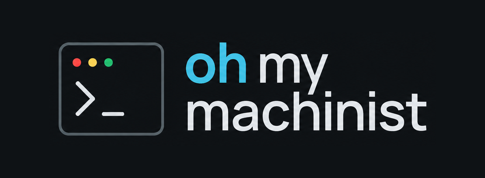

<p align="center">
  
</p>

## About this fork

This is a fork of [Machinist](https://github.com/owainlewis/machinist). It keeps the upstream control plane and worker model, and adds factory features for tracker-driven delivery.

What this fork adds today:

- Plane intake (label poll and webhook), project-to-repository mapping, and Plane/PR links on runs
- Tasks board: one card per ticket with prior attempts, active/failed by default, Show succeeded, URL-persisted filters, and project/date filters
- Run page: attempt picker, transcript tab, full-height transcript, and activity sidebar with state timings
- Retries that inject the prior attempt transcript into the next coder prompt
- Job timeouts with fail alerts, and Plane-driven resolve when a ticket or linked PR completes
- Fresh fetch of lane checkouts before each run
- Built-in PR review after a pull request opens (checks, reviewers, commit status)

The coding agent is whatever executor you configure on the worker: omp, Codex, Claude Code, or another command that reads a prompt on stdin. Models are chosen through that executor configuration (local or cloud). One example setup is DGX Sparks running a local GLM via omp.

Pluggable trackers (Plane or Linear) and per-project agent and model choice are in progress, not done yet.


<p align="center">
  
</p>

<p align="center">
  <strong>The open source AI software factory for agentic coders.</strong><br>
 Machinist is an open source software factory for repeatable and scalable AI coding workflows. 
</p>

<p align="center">
  <a href="https://machinist.sh">Website</a> ·
  <a href="docs/README.md">Documentation</a> ·
  <a href="docs/configuration.md">Configuration</a> ·
  <a href="examples/workflows/README.md">Workflow examples</a>
</p>

<p align="center">
  
</p>

<p align="center"><sub>Machine section · supervised agent system · exploded assembly</sub></p>

Machinist is an open-source software factory implementation. It runs on your machine, keeps repository access and credentials local, and records the work from request to handoff. Commands can invoke Codex, Claude Code, another agent CLI, a test runner, a shell script, or repository-owned orchestration.

Please note: this is early access software and subject to change. 

## Why Machinist

- **One controlled entrypoint.** Workers expose named commands and repositories, never arbitrary shell text or machine-local paths.
- **Bring your own harness.** Use any executable that accepts a prompt on standard input.
- **Keep authority local.** Repositories, credentials, model aliases, and executor configuration stay on the worker.
- **Inspect every run.** Stream output, retain durable events and artifacts, and track terminal outcomes, duration, and reported token use.
- **Choose where to approve.** Pause before a step, review its files, and approve or request changes. Optional merge policies can automate narrowly defined low-risk changes.

<a id="quick-start"></a>

## Quick start

Build and initialize Machinist:

```sh
git clone https://github.com/owainlewis/machinist.git
cd machinist
mkdir -p ./bin && go build -o ./bin/machinist ./cmd/machinist
./bin/machinist init
```

`init` writes `~/.machinist/config.toml` with two commands, `task-to-pr` and `audit`.
Each is a prompt, an executor, and a timeout:

```toml
# ~/.machinist/config.toml
[commands.task-to-pr]
executor = "codex"
prompt_file = "prompts/task-to-pr.md" # optional
timeout = "120m"
```

Run it directly:

```sh
./bin/machinist run --command=task-to-pr --repo=/path/to/repo --prompt="Complete https://github.com/owner/repo/issues/42"
```

## How execution works

For a direct run, Machinist maps the configured command name to a fixed executable and uses the path supplied with `--repo` as the working directory. Managed submissions instead resolve an approved repository name from the worker configuration. In both cases, Machinist renders the prompt, sends it on standard input, streams stdout and stderr, and applies one overall timeout and cancellation. Exit code 0 succeeds; every non-zero exit code fails.

Inside each command, scripts are intentionally opaque. Their internal stages appear in logs, but Machinist does not infer their internal stages. A killed script restarts from the beginning unless the script owns checkpointing.

For explicit steps, [configure a workflow](docs/workflows.md):

```toml
[workflows.deliver]
steps = ["task-to-pr"]
```

Workflow tasks retain results and saved files, support approval and feedback, and keep earlier attempts in history. Each stage can read and write `{{task.output_dir}}`; Machinist restores and saves the shared folder between stages.

Start with [your first task workflow](docs/task-guide.md): create a task from an issue or spec, follow it on the board, and review the result. The [classify-then-merge example](examples/workflows/risk_delivery/README.md) adds independent risk assessment and a conservative merge policy.

## Go deeper

<a id="ohmymachinist"></a>

## OhMyMachinist

This fork adds two generic issue sources and delivery metadata:

- **Plane and Linear adapters.** Both can poll a configured label and submit a source-neutral issue. Plane uses `PLANE_URL`, `PLANE_WORKSPACE`, and `PLANE_API_KEY`; Linear uses `LINEAR_API_KEY`. Configure project-to-repository mappings and poll cadence in `config.toml`. HMAC-verified webhook intake is available as a library helper.
- **Job metadata.** Workflow steps may set `metadata` in their JSON step result. The job page shows optional issue, branch, pull request, preview, review verdict/summary, screenshots, status, and timestamps. Job titles use `KEY: Title`, and job lists expose the full title in a tooltip when clipped.
- **Generic delivery example.** `examples/factory/delivery.sh` has a dry-run mode and separate code/review stages. It never merges or deploys.

### Post-PR review

`deploy/factory/post_pr_review.py` reviews an existing pull request after delivery. It classifies changed files, runs configured checks for the languages in the diff, classifies failures as new or pre-existing, runs code and prose reviewers, performs a docs pass, and posts one PR comment. It also sets the `machinist/review` commit status.

```sh
python3 deploy/factory/post_pr_review.py --repo <checkout> --pr <github-pr-url-or-owner/name#n> [--base <branch>] [--executor-cmd "<cmd ...>"] [--dry-run] [--json-out <path>] [--timeout-seconds <seconds>]
```

- Exit codes: `0` pass, `2` blocked by new check failures or critical/bug findings, `3` review tool error.
- Executor: set `MACHINIST_REVIEW_EXECUTOR` or pass `--executor-cmd`. The command must read a prompt on stdin and print the final answer. With neither set, reviewers and docs are skipped with an explicit note.
- Timeouts: default to 900 seconds per command; set `MACHINIST_REVIEW_TIMEOUT_SECONDS` or `--timeout-seconds`.
- Dry run: prints the comment body and planned commands without calling GitHub write APIs, pushing, or committing.

Wire it after delivery with:

```sh
python3 deploy/factory/post_pr_review.py --repo "$repo" --pr "$(jq -r .pr "$MACHINIST_OUTPUT_DIR/pr.json")"
```

Configure branch protection to require the `machinist/review` commit status so blocked pull requests cannot merge. The tool never merges, approves, or closes pull requests.

To follow upstream while keeping this fork:

```sh
git fetch upstream
git merge upstream/main
```

Configure sources with placeholder values, then replace only the local values:

```sh
export PLANE_URL=https://plane.example.com
export PLANE_WORKSPACE=
export PLANE_API_KEY=
export LINEAR_API_KEY=
```

| Guide | What it covers |
| --- | --- |
| [Documentation](docs/README.md) | Choose the right setup and operations guide |
| [Task workflow guide](docs/task-guide.md) | Set up planning, approval, shared files, and build |
| [Configuration](docs/configuration.md) | Commands, executors, workers, models, and repositories |
| [Development](docs/development.md) | Build, test, and work on Machinist locally |
| [VM deployment](docs/vm-deployment.md) | Run the control plane and worker as services |
| [Workflow examples](examples/workflows/README.md) | Prompt-driven and scripted workflows |

## Contributing

Read [CONTRIBUTING.md](CONTRIBUTING.md) for development setup and pull-request expectations. Security issues should follow [SECURITY.md](SECURITY.md).

Machinist is released under the [MIT License](LICENSE).
